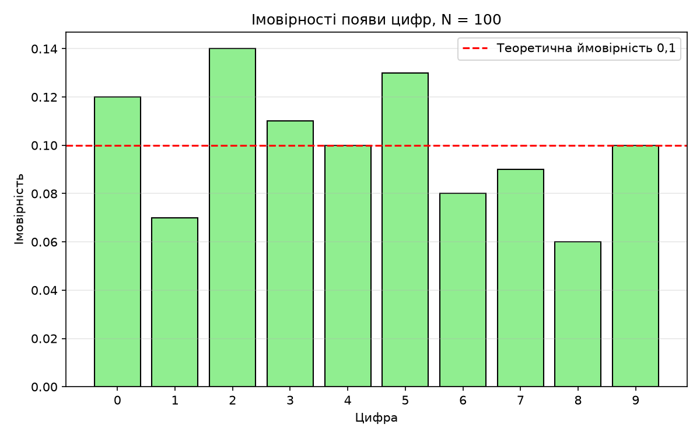
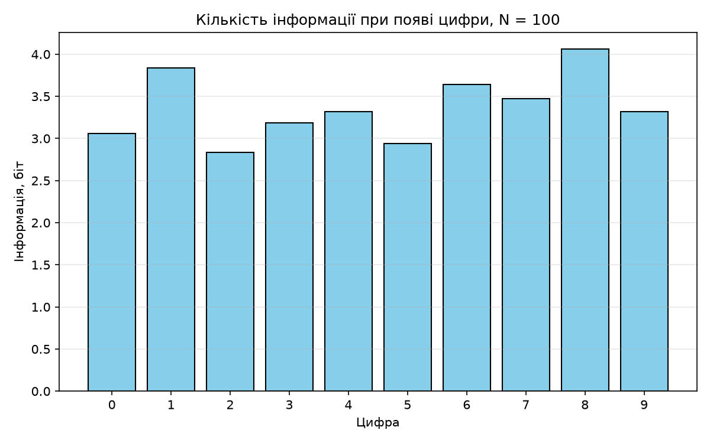
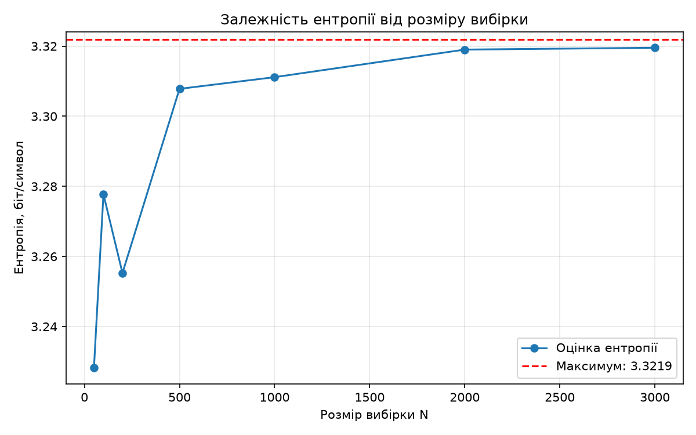

# Лабораторна робота №6 — Кількісна оцінка інформації

## Вибірка N = 100

```text
[9, 4, 5, 8, 0, 7, 3, 0, 2, 1, 5, 7, 3, 6, 8, 1, 9, 3, 0, 3, 6, 4, 2, 6, 2, 1, 2, 9, 9, 7, 2, 2, 0, 0, 3, 3, 2, 2, 4, 5, 3, 8, 3, 2, 3, 6, 4, 0, 5, 6, 2, 2, 4, 1, 5, 4, 9, 9, 0, 9, 5, 1, 4, 5, 4, 7, 5, 2, 7, 7, 2, 0, 4, 0, 5, 6, 0, 8, 6, 5, 6, 9, 0, 7, 0, 2, 9, 3, 1, 3, 7, 5, 8, 5, 8, 4, 7, 1, 9, 5]
```

| Цифра | Кількість появ | Імовірність | Інформація, біт |
|---|---|---|---|
| 0 | 12 | 0.1200 | 3.0589 |
| 1 | 7 | 0.0700 | 3.8365 |
| 2 | 14 | 0.1400 | 2.8365 |
| 3 | 11 | 0.1100 | 3.1844 |
| 4 | 10 | 0.1000 | 3.3219 |
| 5 | 13 | 0.1300 | 2.9434 |
| 6 | 8 | 0.0800 | 3.6439 |
| 7 | 9 | 0.0900 | 3.4739 |
| 8 | 6 | 0.0600 | 4.0589 |
| 9 | 10 | 0.1000 | 3.3219 |





## Ентропія для різних розмірів вибірки

| N | Ентропія, біт/символ |
|---|---|
| 50 | 3.2282 |
| 100 | 3.2777 |
| 200 | 3.2553 |
| 500 | 3.3078 |
| 1000 | 3.3112 |
| 2000 | 3.3190 |
| 3000 | 3.3196 |


