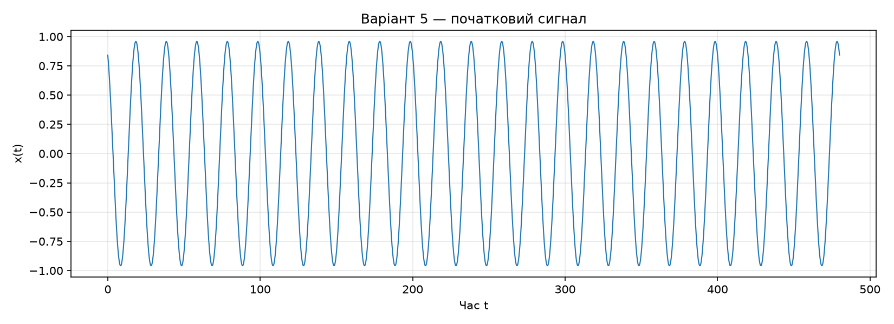
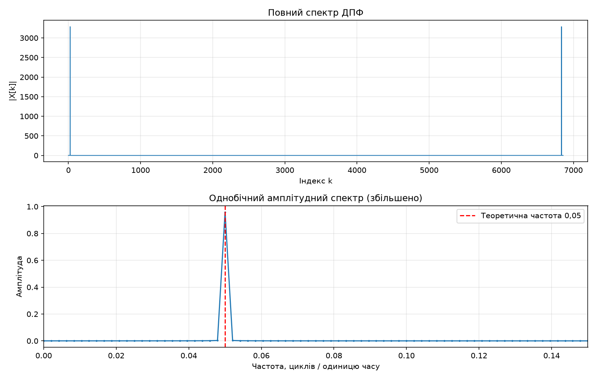
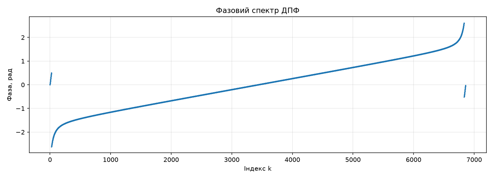
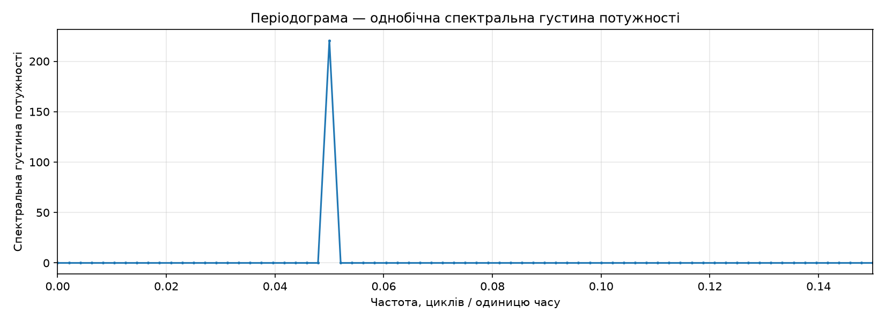
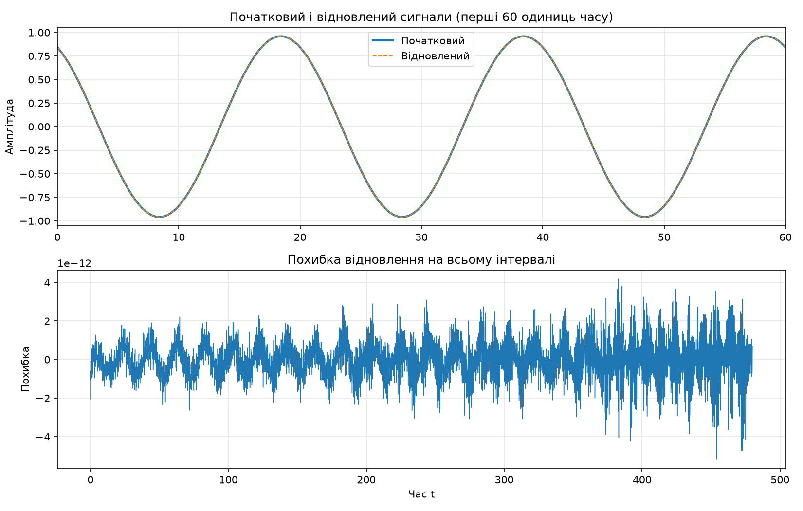

# Лабораторна робота №7 — Результати

| Параметр | Значення |
|---|---:|
| Крок часу | 0.07 |
| Кількість відліків | 6858 |
| Початковий час | 0.00 |
| Останній відлік часу | 479.99 |
| Частота дискретизації | 14.28571429 |
| Крок частот | 0.00208307 |

## Числові результати

| Величина | Значення |
|---|---:|
| Індекс основного піка | 24 |
| Частота основного піка | 0.04999375 |
| Однобічна амплітуда основного піка | 0.95886942 |
| Фаза основного піка, рад | 0.50937092 |
| Максимальна похибка відновлення | 5.192e-12 |
| Максимальний залишок уявної частини | 5.528e-12 |
| Час прямого ДПФ, с | 1.8239 |
| Час оберненого ДПФ, с | 1.7288 |

## Графіки

    