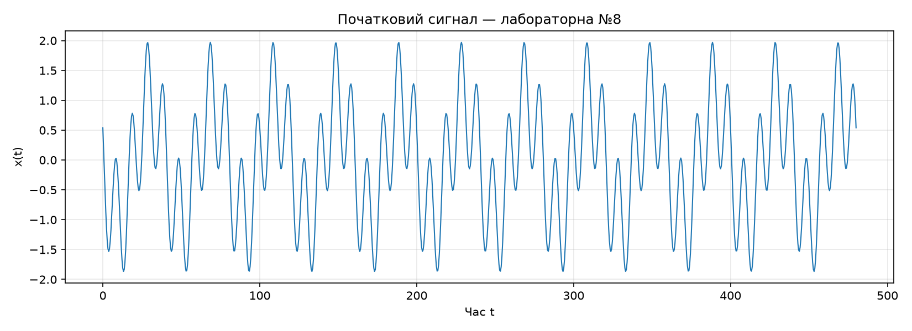
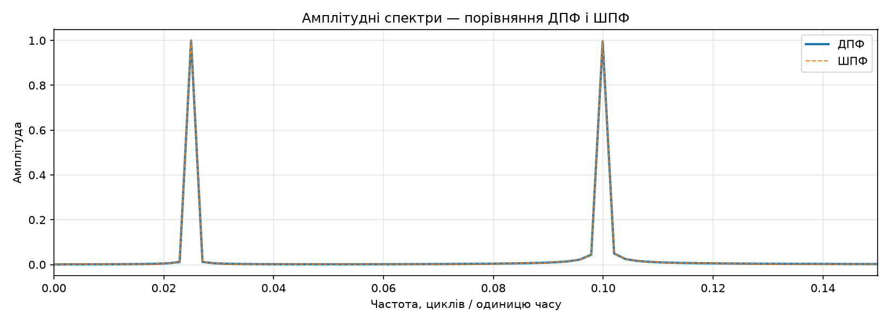
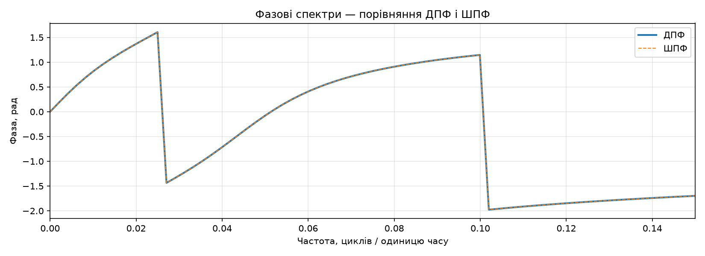
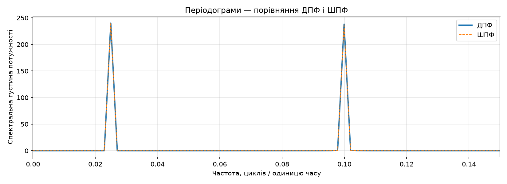
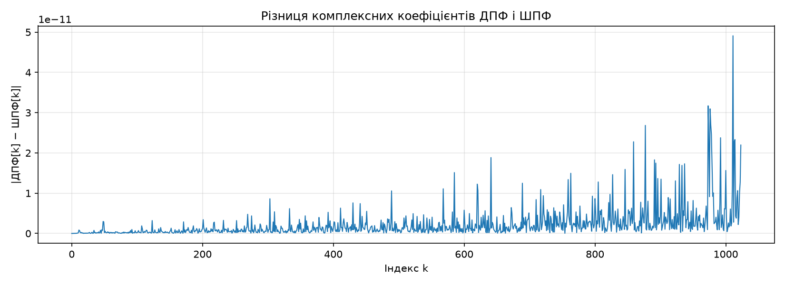
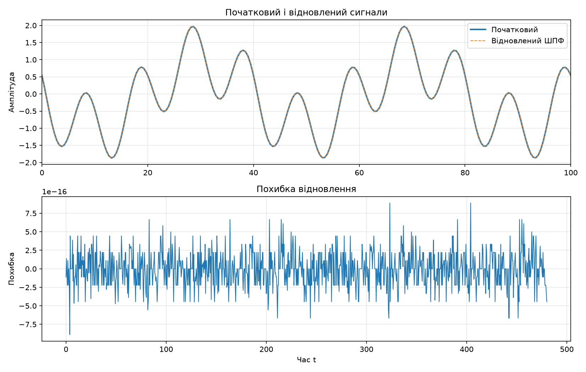
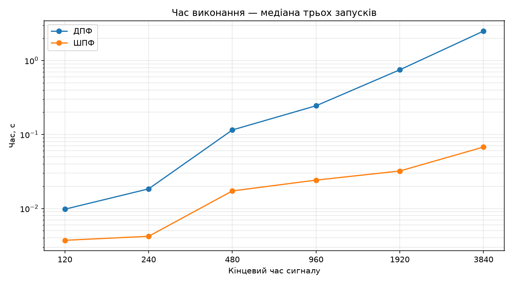

# Лабораторна робота №8 — Результати

| Параметр | Значення |
|---|---:|
| Крок часу | 0.46920821 |
| Кількість відліків | 1024 |
| Початковий час | 0.00 |
| Останній відлік часу | 480.00 |
| Частота дискретизації | 2.13125000 |
| Крок частот | 0.00208130 |
| Кількість запусків для вимірювання часу (медіана) | 3 |

## Основні піки ШПФ

| Індекс k | Частота | Однобічна амплітуда | Фаза, рад |
|---|---:|---:|---:|
| 12 | 0.02497559 | 0.99972016 | 1.60648632 |
| 48 | 0.09990234 | 0.99573711 | 1.14652734 |

## Порівняння та відновлення

| Величина | Значення |
|---|---:|
| Максимальна різниця комплексних коефіцієнтів ДПФ і ШПФ | 4.909e-11 |
| Максимальна похибка відновлення | 8.882e-16 |
| Максимальний залишок уявної частини | 9.671e-16 |
| Час прямого ДПФ, с | 0.115121 |
| Час прямого ШПФ, с | 0.017261 |
| Час оберненого ШПФ, с | 0.009855 |
| Прискорення прямого ШПФ відносно ДПФ, разів | 6.67 |

## Час виконання для різних часових інтервалів

| Кінцевий час | N | Крок часу | ДПФ, с | ШПФ, с | Прискорення, разів | Максимальна різниця коефіцієнтів |
|---|---:|---:|---:|---:|---:|---:|
| 120 | 256 | 0.47058824 | 0.009779 | 0.003712 | 2.63 | 2.896e-12 |
| 240 | 512 | 0.46966732 | 0.018405 | 0.004207 | 4.38 | 1.371e-11 |
| 480 | 1024 | 0.46920821 | 0.115121 | 0.017261 | 6.67 | 4.909e-11 |
| 960 | 2048 | 0.46897899 | 0.244452 | 0.024178 | 10.11 | 1.846e-10 |
| 1920 | 4096 | 0.46886447 | 0.748854 | 0.032095 | 23.33 | 5.725e-10 |
| 3840 | 8192 | 0.46880723 | 2.496816 | 0.067674 | 36.89 | 3.844e-09 |

## Графіки

