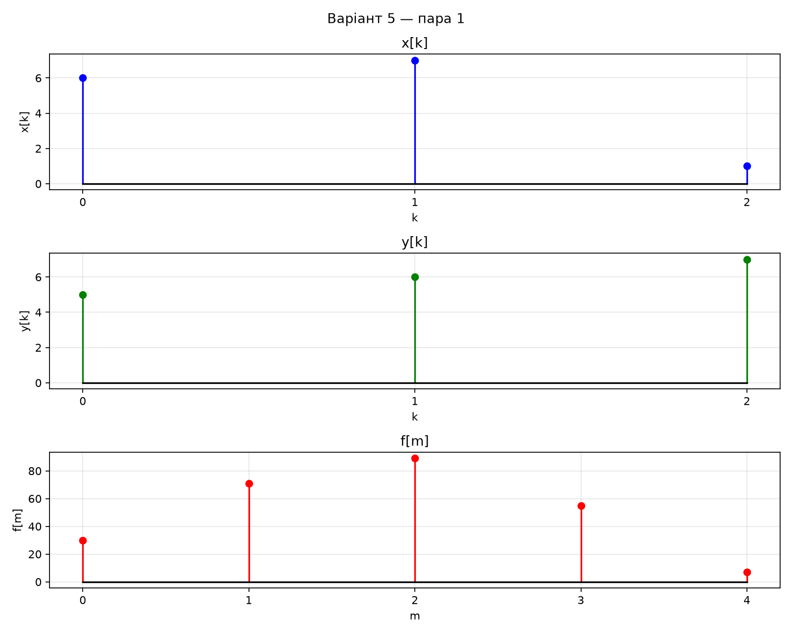
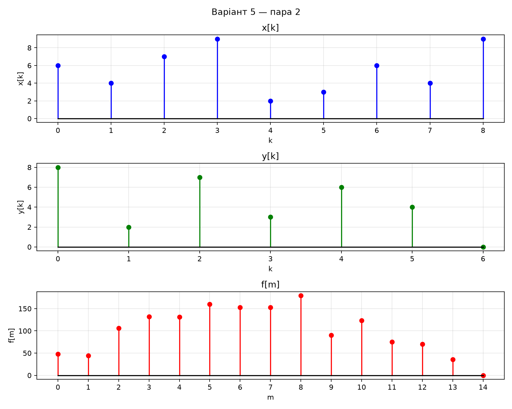
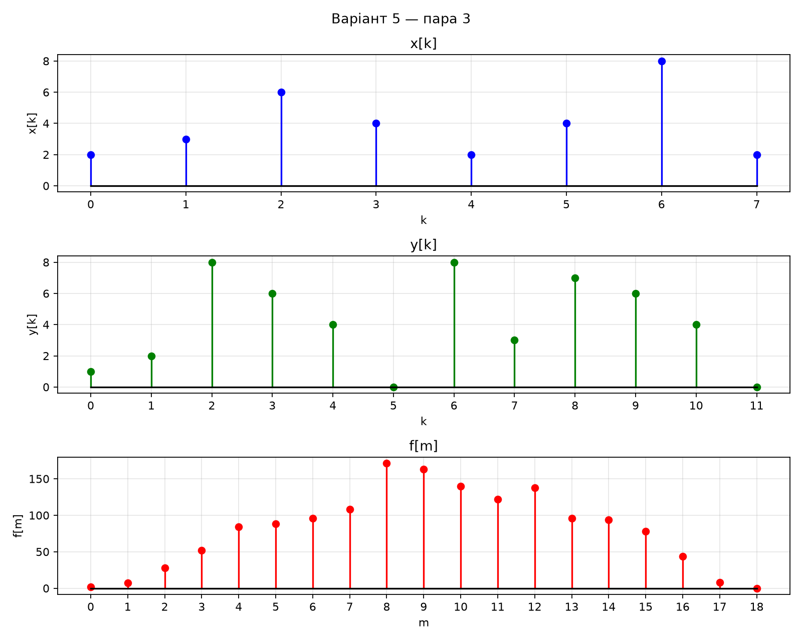

# Лабораторна робота №9 — результати, варіант 5

## Пара 1

- x[k] = [6, 7, 1]
- y[k] = [5, 6, 7]
- f[m] = [30, 71, 89, 55, 7]
- Довжини: x — 3, y — 3, f — 5.
- Перевірка з numpy.convolve: збігається.

## Пара 2

- x[k] = [6, 4, 7, 9, 2, 3, 6, 4, 9]
- y[k] = [8, 2, 7, 3, 6, 4, 0]
- f[m] = [48, 44, 106, 132, 131, 160, 153, 153, 179, 90, 123, 75, 70, 36, 0]
- Довжини: x — 9, y — 7, f — 15.
- Перевірка з numpy.convolve: збігається.

## Пара 3

- x[k] = [2, 3, 6, 4, 2, 4, 8, 2]
- y[k] = [1, 2, 8, 6, 4, 0, 8, 3, 7, 6, 4, 0]
- f[m] = [2, 7, 28, 52, 84, 88, 96, 108, 171, 163, 140, 122, 138, 96, 94, 78, 44, 8, 0]
- Довжини: x — 8, y — 12, f — 19.
- Перевірка з numpy.convolve: збігається.

